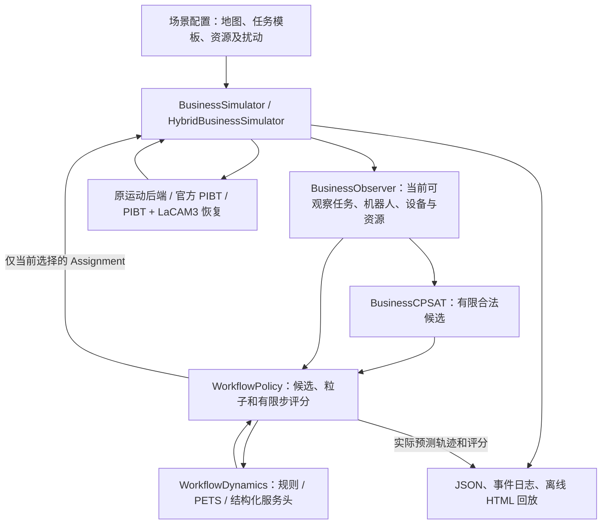

# 样本转运世界模型系统：论文工程架构

本文记录仓库已有系统和本次演示入口，不把仿真假设写成真实医院参数。可运行命令、输出和验收范围见[系统演示说明](system-demo.md)；完整工作流实验及其限制见[PR #15 结果](workflow-prediction-results.md)。

## 需求与边界

系统在离散地图上管理已经释放的样本任务、多个机器人、站点与共享容量。一个业务样本可包含多个按公开模板顺序执行的运输阶段；调度器向空闲机器人分配当前合法阶段，设备不可用或容量不足时等待。任务表、站点、容量、时长及故障时刻是仿真假设，不是经过临床核验的数据。

系统不实现真实机器人定位、SLAM、底层导航控制、人员避障、设备接口或物理安全认证。公开地图、离散无碰撞和仿真任务完成不能证明真实实验室可部署。

## 状态与动作

`ObservationV2`及业务扩展包含当前时刻、机器人位置/任务/执行阶段/已观察服务进度、已释放阶段的 ID/业务 ID/状态、公开工作流、站点设备状态、服务历史以及共享资源容量和已观测占用。有效服务进度依据连续可见的设备状态和服务开始事件计算；真实部署需要等价设备遥测，历史不完整时必须保留未知值。站点等待和接近数量是由可观察任务推导的需求代理，不是 FIFO 实体队列。

动作是 `Assignment(robot_id, sample_id)` 的合法集合。`WorkflowDynamics.predict_next(observation, assignments)` 以当前状态和动作生成下一状态：地图邻接、机器人运动和任务生命周期遵守现有规则；工作站服务是否完成分别由规则、PETS 或结构化服务头给出。已知业务阶段完成后，后继在下一观测边界按公开模板释放，保持待分配；最终阶段结束才代表业务任务完成。容量关系由既有 `capacity_view()` 更新，业务转移检查器核验新阶段的来源和时序。

在线输入不包括未来外部任务、未知未来故障、仿真器服务剩余倒计时或事实未来轨迹。完整场景和事实轨迹只在运行结束后的离线输出中保存，供审计和对照；即使保存了完整配置，也不向策略传递未来事件。

## 调度、预测及运动

`BusinessCPSAT` 使用 OR-Tools 生成有界合法候选；`WorkflowPolicy` 对每个候选使用同一预测窗口和粒子预算调用动作条件世界模型，依据完整已知业务任务评分选出当前分配。当前评分主要由窗口内未完成任务步数与窗口末预估剩余运输及服务工作量组成，资源竞争代理和距离用于平局判断；它不是未来真实流转时间，也不是 FIFO 排队模型。最近优先是无需模型的独立基线。

执行端可选旧后端、官方 PIBT，或 PIBT + LaCAM3 混合恢复。混合后端观测到规定的业务不进展与联合位置重复后，以固定预算调用官方 LaCAM3，成功时执行并缓存完整联合路径；任务目标、锁定状态和实际位置变化会触发检查或失效。`RecoveryMovementModel` 将可复制的恢复快照传入预测分支，避免分支共享可变执行缓存。相同运动接口不等于未来服务和异常均能预测正确。旧后端含模型未必覆盖的恢复机制，演示输出会标注该限制。

`business_transport/demo.py` 复用上述策略、仿真器、模型和 PR #15 评价入口；可选开关从真实在线推演保存每个候选、粒子、动作和预测状态，不重新运行模型来伪造预测。`lab_transport/report.py` 的地图、时间轴和事件回放被业务页面复用，并增加样本完整流程、容量、预测和恢复事件。只有已执行候选可与事后事实并列，其他候选没有事实反事实标签。

## 方法来源及代码位置

| 职责 | 来源及实现 |
|---|---|
| 业务参照 | Zhou 等，2025，[多机器人多任务自动化实验室调度](https://doi.org/10.1039/D4DD00313F)；本项目没有复现其真实实验室参数或全部系统。 |
| 约束调度 | Google [OR-Tools flexible job shop 示例](https://github.com/google/or-tools/blob/100f66e6242ab8bf8d32feb8f3bf086db66ae2b5/examples/python/flexible_job_shop_sat.py)，Apache-2.0；项目适配见 `business_transport/dispatch.py` 和 `lab_transport/paper_reuse/ortools_dispatch.py`。 |
| 概率服务预测 | Chua 等的 [PETS](https://arxiv.org/abs/1805.12114) 与 Meta MBRL-Lib `GaussianMLP`，固定版本及兼容性见[集成报告](paper_reuse_integration.md)。实际训练和本项目服务预测不等同于论文原始连续控制实验。 |
| 路径协调 | [PIBT 官方实现](https://github.com/Kei18/pibt2)，`faab5b916649549f1cd563df8dbf6e4f6382f631`；[LaCAM3 官方实现](https://github.com/Kei18/lacam3)，`1c3ecf8ade40298f16047544634e9c0c1cf3b93c`。许可与薄桥见 [PIBT 结果](pibt-motion-results.md)、[LaCAM3 结果](lacam3-recovery-results.md)。 |

## 指标、已有证据和局限

完整任务完成率的分母包括未完成业务任务；完整任务平均流转只对已完成任务有意义，另报告按运行上限截断的受限流转。容量等待、设备不可用等待、顶点/交换边冲突、非法边、重复分配及生命周期违规使用各自日志和既有检查器。决策耗时为实际墙钟，包括求解、候选推演、校验、评分和本演示的轨迹记录；不是 GPU 推理延迟或实时性保证。

一步、三步、五步业务联合正确率在同一条最近优先事实轨迹上离线评价，模型使用相同选中窗口；它不混合各策略的闭环轨迹，也不把重叠窗口当作独立场景。更完整的 PR #15 已见地图确认结果：规则/PETS/结构化头一步分别为 121/137、116/137、104/137，五步分别为 55/83、32/83、23/83；学习模型没有显示稳定闭环收益。具体定义和置信范围见[原报告](workflow-prediction-results.md)。本次默认单场景是演示，不新增独立模型结论。

LaCAM3 对有向地图、锁定目标及部分业务约束存在不支持或无法保证可达的情况，触发失败时保留回退；clinic 的成功不能推广为所有布局保证活性。模型预测误差可累积，时间预算、候选截断以及数据和故障分布均影响效果。扩展到真实系统前仍需真实工作站与服务遥测、隐私和接口设计、真实地图与业务规则核验、长时运行及独立物理安全工程。
